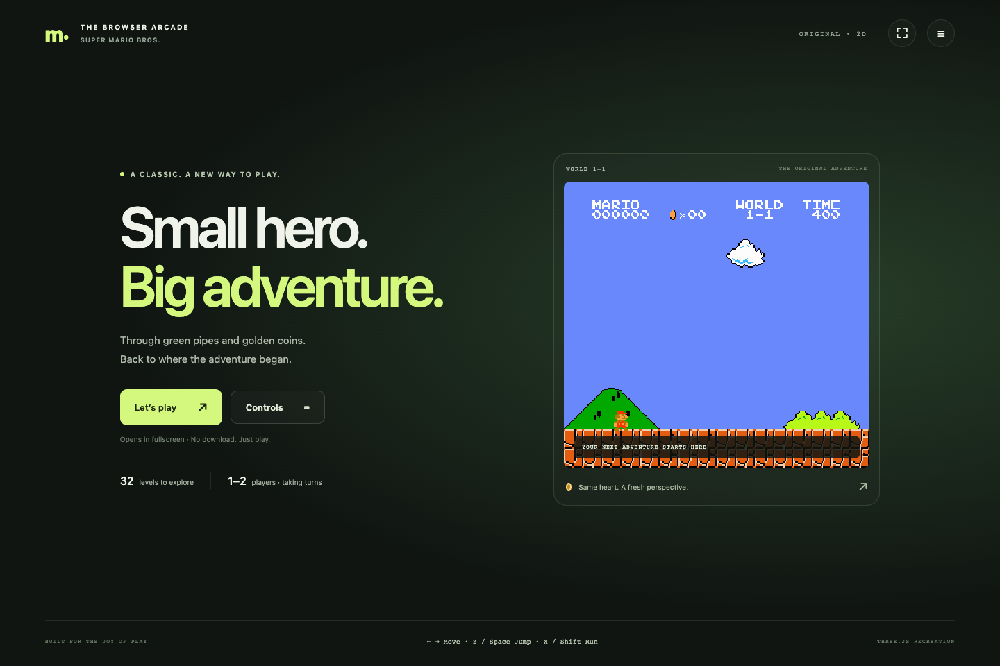

# GhostRun Arcade

**Retro games rebuilt as browser games.** The playable showcase for [GhostRun](https://github.com/kdcyberdude/ghostrun), a Hermes Agent plugin that learns a game, trains a player, and supplies a black-box reference to a separate builder.

This first showcase contains an independent Three.js / TypeScript recreation of Super Mario Bros. with all 32 level definitions. The browser runs the simulation in `src/`; it does not load a ROM, an emulator, or a neural network.

**[Play in your browser](https://kdcyberdude.github.io/ghostrun-arcade/)** · [Plugin](https://github.com/kdcyberdude/ghostrun) · [Training lab](https://github.com/kdcyberdude/ghostrun-lab) · [How the pipeline works](https://github.com/kdcyberdude/ghostrun/blob/main/docs/ARCHITECTURE.md)



## Play locally

Use Node.js 20 or newer:

```sh
npm ci
npm run dev
```

Choose Play on the home screen. Arrow keys move, Z/Space jumps, X/Shift runs or fires, and Enter pauses. Touch controls, two-player keyboard mappings, sound, fullscreen, and remapping are available in the interface.

```sh
npm test
npm run build
npm run preview
```

The production build is a static site. Relative asset paths support both a domain root and GitHub Pages project paths. Compressed audio keeps the download small while retaining the supplied music and effects.

## What this demonstrates

- A multi-level browser simulation built through observation and iterative comparison with a reference game.
- Gameplay code that can be inspected, modified, and tested independently of the reference process.
- A separation between gameplay and rendering. The latest physics lives in one simulation; an additional renderer should consume that same state.

The public launch is **2D only**. The recovered 3D code and assets are preserved on [`codex/recovered-3d-preview`](https://github.com/kdcyberdude/ghostrun-arcade/tree/codex/recovered-3d-preview) for later work. Its first-level footage appears in the [70-second demo](https://github.com/kdcyberdude/ghostrun-arcade/releases/tag/v0.2.0-demo) as an experimental preview.

## Evidence and limits

The research project reports recorded-input browser replays through all 32 levels. That is different from a policy completing this remake in a fresh, closed-loop run. A current replay of the fixed native action stream stops progressing after 1-2. Remaining contact, timing, and geometry discrepancies mean this is not a claim of exact equivalence.

Unit fixtures capture measured mechanics. Full native campaign comparisons additionally require the retained reference traces, which are not bundled in this public source package. A passing build or unit suite does not replace that comparison. See [verification](docs/VERIFICATION.md).

The [older player](https://huggingface.co/kdcyberdude/ghostrun-smb-policy-v1) follows a successful fixed route in its original environment. The [newer explorer](https://huggingface.co/kdcyberdude/ghostrun-smb-policy-v2) has eight moods and is still being trained. Its model card records its failures and current coverage. Neither model runs in this browser page.

## Where to look

| Part | Location |
|---|---|
| Gameplay and physics | `src/simulation.ts`, `src/native-motor.ts`, other motion modules |
| 2D renderer and sound | `src/renderer.ts`, `src/audio.ts` |
| Controls, loading and menus | `src/controls.ts`, `src/loading.ts`, `src/shell.ts` |
| Compiled levels and observations | `data/` |
| Regression fixtures | `tests/`, `evidence/` |
| Plugin reliability and reward design | [GhostRun documentation index](https://github.com/kdcyberdude/ghostrun/blob/main/docs/INDEX.md) |
| Training code and recording tools | [GhostRun Lab](https://github.com/kdcyberdude/ghostrun-lab) |

This repository is the playable showcase; plugin installation does not download it. Future game recreations can join the same showcase without expanding the Hermes catalog submission.

## Attribution

This is an unofficial research recreation, not a Nintendo product. Original game artwork, music, characters and trademarks belong to their respective owners. No ownership or open-source license for those assets is asserted here. See [third-party notices](THIRD_PARTY.md).
