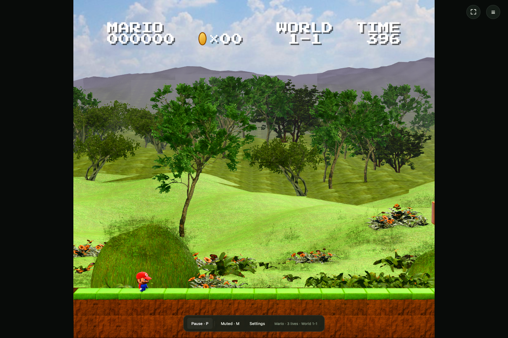

# Super Mario Bros. recreation

An independent Three.js / TypeScript recreation of Super Mario Bros. with all 32 level definitions. The browser runs the simulation in `src/`; it does not load a ROM, an emulator, or a neural network. It is served at the arcade's root URL.



## Play locally

From the arcade root (Node.js 20 or newer):

```sh
npm ci
npm run dev
```

Choose the 2D or 3D version on the home screen (`?view=3d` opens 3D directly). For 3D, resolution and graphics default to Auto; either can be set by hand before or during play. Home in the game bar returns to this screen. Arrow keys move, Z/Space jumps, X/Shift runs or fires, and Enter pauses. Touch controls, two-player keyboard mappings, sound, fullscreen, and remapping are available in the interface.

Game-only commands run from this folder or with `-w games/smb` from the root:

```sh
npm test
npm run build
npm run preview
```

The production build is a static site. Relative asset paths support a domain root, a GitHub Pages project path and the arcade's `/<game>/` subpaths. Compressed audio keeps the download small while retaining the supplied music and effects.

## What this demonstrates

- A multi-level browser simulation built through observation and iterative comparison with a reference game.
- Gameplay code that can be inspected, modified, and tested independently of the reference process.
- Two presentations of the same current simulation: original-style 2D and a 3D world with rigged characters, lighting and scenery.

Both views share the updated physics, interactions, controls and original audio. The 3D renderer changes presentation only, with resolution options up to the 4K preset (2304 × 2160, preserving the original aspect ratio). The game keeps full speed down to 30 drawn frames a second by running up to two game frames per drawn frame; below that the whole game slows in proportion. An optional frame-rate counter shows this. Resolution and graphics default to Auto, which aims for at least 30 fps at the best-looking setting rather than 60 at a lower one. It walks one ladder ordered by how good it looks to play (0.5K Low, 0.5K High, 1K Low, 1K High, 2K Low, 4K Low, 2K High, 4K High, 2K Ultra, 4K Ultra): after two seconds under 30 it drops straight to the best level expected to hold 33, after six steady seconds with room to spare it tries one level up (going back if that falls under 30), and it remembers the result per browser. See the [3D asset and renderer notes](visual3d/README.md).

## Evidence and limits

The research project reports recorded-input browser replays through all 32 levels. That is different from a policy completing this remake in a fresh, closed-loop run. A current replay of the fixed native action stream stops progressing after 1-2. Remaining contact, timing, and geometry discrepancies mean this is not a claim of exact equivalence.

Unit fixtures capture measured mechanics. Full native campaign comparisons additionally require the retained reference traces, which are not bundled in this public source package. A passing build or unit suite does not replace that comparison. See [verification](docs/VERIFICATION.md).

The [older player](https://huggingface.co/kdcyberdude/ghostrun-smb-policy-v1) follows a successful fixed route in its original environment. The [newer explorer](https://huggingface.co/kdcyberdude/ghostrun-smb-policy-v2) has eight moods and is still being trained. Its model card records its failures and current coverage. Neither model runs in this browser page.

## Where to look

| Part | Location |
|---|---|
| Gameplay and physics | `src/simulation.ts`, `src/native-motor.ts`, other motion modules |
| 2D renderer and sound | `src/renderer.ts`, `src/audio.ts` |
| 3D renderer and asset builders | `src/render3d/`, `visual3d/` |
| Recorded-input clips and per-level recordings | [Recording guide](docs/RECORDINGS.md), `tools/harness/record-levels-audio.mjs` |
| Controls, loading and menus | `src/controls.ts`, `src/loading.ts`, `src/shell.ts` |
| Compiled levels and observations | `data/` |
| Regression fixtures | `tests/`, `evidence/` |

## Attribution

This is an unofficial research recreation, not a Nintendo product. Original game artwork, music, characters and trademarks belong to their respective owners. No ownership or open-source license for those assets is asserted here. See [third-party notices](THIRD_PARTY.md).
